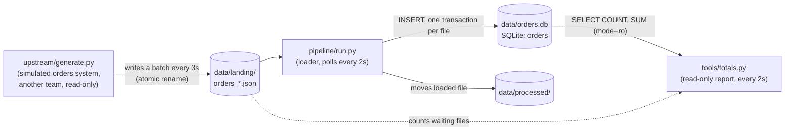

# Brightcart orders pipeline

A small, stdlib-only Python data pipeline. A simulated upstream orders system drops JSON order
files into a landing directory, the pipeline loads them into SQLite, and a totals tool prints
order count and revenue for finance.



| Component | Role |
| --- | --- |
| `upstream/generate.py` | Fake Brightcart orders system. Writes 3-5 orders per file to `data/landing/` every 3 seconds (`--once` writes one file and exits). Simulates another team's system: **do not modify**. |
| `pipeline/run.py` | Polls `data/landing/` every 2 seconds, loads each `orders_*.json` into `data/orders.db`, then moves the file to `data/processed/`. |
| `tools/totals.py` | Every 2 seconds prints `orders=<count> revenue=<sum> waiting=<files in landing>`. Opens the database read-only. |

All runtime state lives under `data/` (gitignored), created on first run. There are no external
services, accounts, or credentials.

## Requirements

- Python 3.12 (pinned in `.python-version`)
- pip 25.1 or newer (for `pip install --group`)

Runtime code uses only the standard library. Dev tools (pytest, pytest-cov, ruff, mypy,
pre-commit) are pinned to exact versions in `pyproject.toml` under `[dependency-groups]`.

## Setup

```sh
python3.12 -m venv .venv
. .venv/bin/activate
python -m pip install --upgrade pip
python -m pip install --group dev
pre-commit install          # optional: run ruff, mypy, and file checks on every commit
```

There is no build step; the scripts run directly from the checkout.

## Run it end to end

Use three terminals, each with the venv activated, from the repository root:

```sh
# Terminal 1: simulated upstream, writes a batch every 3s
python upstream/generate.py
# wrote data/landing/orders_20261118T160244008331Z_0001.json orders=3 fault=none

# Terminal 2: the pipeline
python pipeline/run.py
# loaded orders_20261118T160244008331Z_0001.json orders=3

# Terminal 3: totals
python tools/totals.py
# 2026-11-18T16:03:56Z orders=7 revenue=1077.77 waiting=0
```

Stop each script with Ctrl-C. To start from a clean slate, stop all three and delete `data/`.

For a quick one-shot check, run `python upstream/generate.py --once`, then start the pipeline
and watch the file move from `data/landing/` to `data/processed/`.

### Simulating upstream faults

`FAULT` is read **only** by `upstream/generate.py` (see `.env.example`). The pipeline and
totals tool never read it; it changes the files upstream produces.

| `FAULT` | Upstream output | Pipeline behavior today |
| --- | --- | --- |
| `none` (default) | Well-formed orders | Loads every order |
| `null_spike` | ~30% of orders have `"customer_id": null` | Loads them with a NULL `customer_id` |
| `schema_drift` | `order_total` renamed to `total_amount` | Crashes with `KeyError: 'order_total'`; the file stays in `data/landing/`, so a restart fails again until that file is moved out |

```sh
FAULT=schema_drift python upstream/generate.py --once
```

## Order-file contract

Upstream writes `data/landing/orders_<utc>_<seq>.json`, where `<utc>` is
`YYYYMMDDTHHMMSSffffffZ`. It writes to a dot-prefixed `.tmp` file first and renames it, so the
pipeline never sees a partial file. Each file is a JSON list of:

```json
{"order_id": "ord_...", "customer_id": "cust_0042", "order_total": 123.45, "currency": "USD", "created_at": "2026-11-18T16:02:44Z"}
```

Loader rules (`pipeline/run.py`):

- Files are loaded in filename order, one transaction per file.
- Every order is loaded as-is; `order_total` values are not range-checked, so zero and negative
  totals load like any other order.
- Each loaded file prints one line: `loaded <filename> orders=<n>`.
- Any bad record (missing field, duplicate `order_id`, invalid JSON) rolls back the whole
  file, leaves it in `data/landing/`, and stops the pipeline with a traceback.

The `orders` table has the columns `order_id TEXT PRIMARY KEY, customer_id TEXT, order_total REAL, currency TEXT, created_at TEXT`.

## Development

```sh
ruff check .               # lint (pycodestyle, pyflakes, naming, complexity, bugbear, ...)
ruff format .              # format
mypy                       # strict type checking (pipeline/, tools/, tests/)
python -m pytest --cov     # full suite with the 90% coverage gate (same as CI)
python -m pytest tests/test_loader.py     # a single file, no coverage gate
python -m pytest -m "not integration"     # skip the subprocess end-to-end tests
```

CI (`.github/workflows/ci.yml`) runs ruff, mypy, and pytest with coverage on every pull request
and on every push to `main`.

See [AGENTS.md](AGENTS.md) for conventions and the rules that apply to every change.
